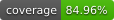

# CONFOR'INO — site vitrine

[](https://github.com/OYETECH225/conforino/actions/workflows/tests.yml)
[](https://github.com/OYETECH225/conforino/actions/workflows/tests.yml)

Site vitrine de CONFOR'INO (rénovation intérieure, agencement cuisine/salle de bain,
adaptation PMR à domicile — Argenteuil, 95), reconstruit en Laravel avec un back-office
Filament permettant de gérer 100 % du contenu sans toucher au code.

## Stack technique

- **Laravel 12** + **Filament v4** (panel d'administration)
- **MySQL** en production / **SQLite** en local (par défaut, zéro friction pour développer)
- **Tailwind CSS v4** (configuration CSS-first via `@theme`, voir plus bas)
- **Blade + Livewire + Alpine.js** (Alpine est fourni par Livewire, pas d'installation séparée)
- **Packages Spatie** : `laravel-sitemap`, `laravel-medialibrary`, `schema-org`,
  `laravel-sluggable`, `laravel-backup`, `laravel-settings`
- Plugins Filament officiels : `spatie-laravel-settings-plugin`, `spatie-laravel-media-library-plugin`

> **Écart assumé par rapport au brief initial** : Laravel 11 et Filament v3 étaient
> demandés, mais au moment de la construction (sept. 2026) la branche Laravel 11 est en
> fin de support sécurité et Filament v3 est remplacé par la v4. Après validation, le
> projet a été construit sur **Laravel 12 (LTS) + Filament v4**, stack équivalente en
> support long terme. Idem pour `tailwind.config.js` : Tailwind v4 (livré par défaut avec
> Laravel 12) utilise une configuration CSS-first (`@theme` dans `resources/css/app.css`)
> plutôt qu'un fichier JS — les couleurs de marque y sont définies au même endroit
> conceptuel, réutilisables partout (front **et** thème du panel Filament).

## Installation

**Prérequis** : PHP 8.4+, Composer 2, Node 20+ (les dépendances Spatie verrouillées
nécessitent PHP 8.4 minimum — voir la note ci-dessus sur l'écart de version).

```bash
composer install
npm install

cp .env.example .env
php artisan key:generate

# SQLite par défaut : le fichier database/database.sqlite est déjà pris en charge
# par la config par défaut de Laravel. Pour MySQL en production, voir plus bas.

php artisan migrate --seed
php artisan storage:link

npm run build   # ou `npm run dev` pendant le développement
php artisan serve
```

Le seeder crée :
- un compte admin **admin@conforino.fr / password** — **à changer immédiatement**
  après la première connexion (`/admin`) ;
- les 12 villes desservies, les 4 prestations et leurs déclinaisons locales
  (paragraphes de démarrage à personnaliser dans l'admin, voir plus bas) ;
- les pages Accueil, Services, FAQ, Contact, Mentions légales, Politique de
  confidentialité, Protection du consommateur, CGV ;
- les redirections 301 connues depuis l'ancien site conforino.fr ;
- 10 vrais avis Google clients (widget Trustindex de l'ancien site — noms, notes
  et textes authentiques, aucun avis inventé).

### Passer en MySQL (production)

Dans `.env` :

```
DB_CONNECTION=mysql
DB_HOST=127.0.0.1
DB_PORT=3306
DB_DATABASE=conforino
DB_USERNAME=...
DB_PASSWORD=...
```

Puis `php artisan migrate --seed` sur la base MySQL.

## Back-office (Filament) — `/admin`

Tout le contenu est administrable sans toucher au code :

- **Pages** (Contenu → Pages) : chaque page est un assemblage de blocs (Hero, Texte riche,
  Grille de services, Témoignages, FAQ, Zones desservies, Formulaire de contact, Chiffres
  clés, Avant/Après), réordonnables par glisser-déposer, plus les champs SEO
  (meta title/description, canonical, robots, type Schema.org, image Open Graph).
- **Prestations (Services)** : les 4 prestations (Agencement cuisine, Agencement salle de
  bain, Aménagement PMR, Rénovation intérieure). L'onglet **Villes desservies** de chaque
  prestation génère automatiquement les pages `/services/{prestation}-{ville}/` — un
  seul gabarit, sans dupliquer le contenu : seul le paragraphe local (`local_intro`) est
  spécifique à chaque couple prestation/ville, à personnaliser pour renforcer la
  différenciation SEO (le texte de démarrage généré par le seeder est volontairement
  générique).
- **Zones desservies (Villes)** : liste des villes, avec une courte description locale.
- **Avis clients** : note, texte, auteur, ville, source (Google/site).
- **Réalisations (avant/après)** : chantiers avec photo avant/après, prestation et ville liées.
- **Redirections 301** : gestion des anciennes URLs de conforino.fr → nouvelles URLs.
- **Demandes de devis (Leads)** : les soumissions du formulaire de contact, avec action
  "Marquer traitée".
- **Réglages du site** (Réglages généraux) : NAP, réseaux sociaux, texte RGPD/cookies,
  contenu de `robots.txt`, IDs GA4/GTM, numéro de call tracking.

## Configuration SEO après mise en ligne

1. **Sitemap** : généré dynamiquement sur `/sitemap.xml` à partir du contenu publié
   (pages, prestations + déclinaisons villes publiées, réalisations). Rien à régénérer
   manuellement — toujours à jour. Soumettez cette URL dans Google Search Console.
2. **robots.txt** : servi dynamiquement sur `/robots.txt` depuis Réglages généraux →
   onglet SEO technique. Vérifiez qu'il pointe bien vers `/sitemap.xml` en absolu une fois
   le nom de domaine définitif connu (`Sitemap: https://votredomaine.fr/sitemap.xml`).
3. **Google Analytics 4 / Google Tag Manager** : renseignez `ga4_id` et/ou `gtm_id` dans
   Réglages généraux. Les scripts ne se chargent qu'**après consentement explicite** sur
   le bandeau cookies (jamais avant), conformément aux recommandations CNIL.
4. **Redirections 301** : avant de couper l'ancien hébergement, vérifiez dans Search
   Console (rapport "Pages") la liste exhaustive des URLs indexées de l'ancien site et
   complétez la table Redirections pour toute URL non déjà couverte par le seeder.
5. **Données structurées (JSON-LD)** : générées automatiquement sur chaque page —
   `LocalBusiness` (+ `AggregateRating` dès qu'il existe des avis publiés) partout,
   `BreadcrumbList` sur toutes les pages sauf l'accueil, `Service` sur les pages
   prestation, `FAQPage` dès qu'un bloc FAQ contient des questions. Validez avec le
   [Rich Results Test](https://search.google.com/test/rich-results) de Google après mise
   en ligne (l'IA ne peut pas vérifier le rendu réel chez Google).
6. **Images** : uploadées via la médiathèque (Spatie Media Library), conversion
   automatique en WebP (`webp`, `thumb`). Renseignez toujours un texte alternatif
   pertinent dans l'admin — c'est un champ requis fonctionnellement pour l'accessibilité
   et le SEO image.

## Accessibilité

Le design respecte le plan validé : contraste AA (le turquoise `#40BBC9` n'est jamais
utilisé en texte courant, uniquement en CTA fond plein/traits/icônes), corps de texte
16px minimum, zones cliquables ≥ 44px, focus clavier visible (anneau turquoise foncé),
`prefers-reduced-motion` respecté (désactive le tracé du logo et les transitions), slider
avant/après opérable au clavier (`<input type="range">`).

## Tests

```bash
php artisan test
```

Couvre : chargement de toutes les pages admin et publiques, unicité du H1 sur l'accueil,
redirections 301, validation du consentement RGPD du formulaire de contact, et la
synchronisation du Page Builder (Filament) vers la table `blocks`.

Le badge de couverture ci-dessus est recalculé automatiquement par la CI à chaque push
sur `main` (`.github/badges/coverage.svg`, généré via PCOV puis committé directement dans le
dépôt — fonctionne aussi en dépôt privé, contrairement à un badge externe pointant vers
`raw.githubusercontent.com`) — inutile de le mettre à jour à la main.

## Sauvegardes

`spatie/laravel-backup` est configuré (`config/backup.php`) et planifié dans
`routes/console.php` (nettoyage 1h, sauvegarde 1h30 chaque nuit). Le serveur de
production doit exécuter `php artisan schedule:run` chaque minute (cron système) pour
que la planification s'active. Vérifiez la destination de stockage des sauvegardes
(disque `local` par défaut — à changer pour un disque distant en production) dans
`config/filesystems.php` / `config/backup.php`.

## Points restés en placeholder (à compléter par CONFOR'INO)

- **Paires avant/après réelles** : les 4 réalisations seedées n'ont qu'une photo
  (le résultat fini, récupérée sur l'ancien site) — aucune "photo avant" n'a été
  inventée. Uploadez de vraies photos avant/après dans Réalisations dès qu'elles
  sont disponibles pour activer le slider de comparaison.
- **Paragraphes locaux par ville** (`local_intro` sur chaque couple prestation/ville) :
  contenu de démarrage généré automatiquement, à personnaliser pour maximiser la
  différenciation SEO entre les pages villes.
- **Avis clients récents** : 10 vrais avis Google historiques sont importés ; pensez à
  ajouter les nouveaux avis au fil de l'eau depuis l'admin.
